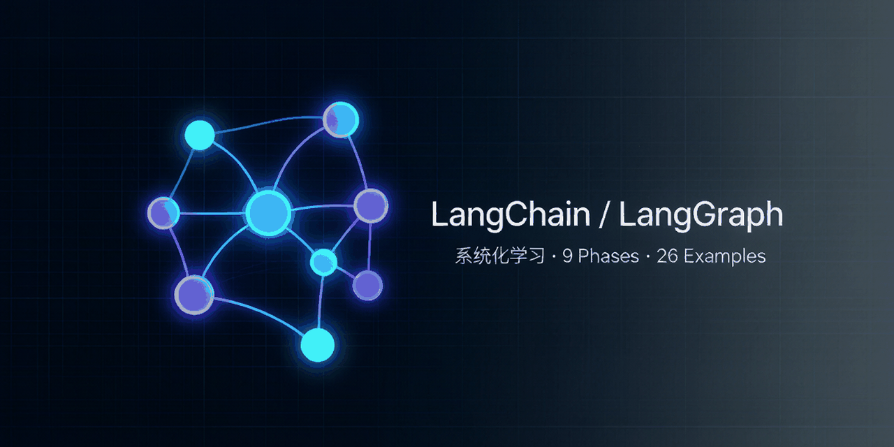

# LangChain & LangGraph: A Systematic Course

> Understand Agent orchestration from first principles: **State Graph + Nodes + Conditional Edges**.



This is a **hands-on, zero-to-production multi-agent systems course**: using LangChain / LangGraph as the vehicle, it takes you from first principles of Agent orchestration (State Graph + Nodes + Conditional Edges) all the way to a full set of production-grade capabilities — persistent memory (checkpoint), human-in-the-loop (HITL), a traceable independent memory layer, MCP tool interfaces, multi-agent collaboration (A2A), service deployment, and observability. It is both a step-by-step learning path and a demonstrable **production-grade multi-agent system reference implementation**.

> **Positioning**: This repo grew out of the official LangChain tutorials, re-engineered and extended — I used it to deeply understand LangGraph's state machine, checkpoint, and HITL internals, then filled the gaps the original tutorials miss (independent memory layer, MCP communication substrate, deployment & observability). If asked in an interview whether it was independently designed, be honest about this; focus on the internals you actually mastered. Its relationship with a self-built kernel project (e.g. "Lingxi") is complementary: one proves you can ship fast with frameworks, the other proves you can build the internals.

Our core thesis: most mainstream Agent frameworks (CrewAI, AutoGen, etc.) can be mapped onto LangGraph's model of **StateGraph + Node + Conditional Edge**. Master LangChain and LangGraph, and you master the underlying paradigm of Agent orchestration.

## Language / 语言

- This project is **bilingual**: Simplified Chinese (default) and English (under `/en/`).
- 本文档提供**双语**：简体中文（默认）与 English（`/en/`）。

## Quick Start (recommended, one command)

This repo ships an **editor-agnostic** `Makefile` that works in the PyCharm / WebStorm terminal, VS Code, or CI:

```bash
make setup        # create .venv, install Python + Node deps, copy .env
make docs         # build the bilingual docs site -> docs/.vitepress/dist
make docs-dev     # live preview at http://localhost:5173
make run p=1      # run Phase 1 example (p=2..13 likewise; configure .env first — see "Configure the LLM" below)
make lint         # py_compile all examples
```

> **Tip — read the docs before coding (recommended):** after `make setup` installs the Node deps above, run `make docs-dev` (or `npm run docs:dev`) and open **http://localhost:5173** in your browser to read the tutorials. The docs site explains each Phase's principles, code, and acceptance checklist in detail. We recommend reading the corresponding Phase chapter in order, then coming back to `make run p=N` to run the example — it works much better that way.

> **IDE usage (PyCharm + WebStorm)**: open the project root in PyCharm for the Python `examples/`; open `docs/` in WebStorm (or just run `make docs-dev` from the PyCharm terminal) for the docs site. Both IDEs have a built-in Terminal to run the `make` commands above.
>
> Requirements: Python 3.13+, Node 22+.

## Reading Flow: understand how these sections relate

> Many readers see the long list of commands in this README and assume that finishing "Quick Start" means the project is done. **It does not.** The sections here fall into three categories — build this mental model first, then start:

**1. Environment setup (one-time)**
- **Quick Start (one command)**: uses the `Makefile` to install the Python + Node environment, copy `.env`, and tell you which `make` commands exist. **It only sets up the environment — it contains no learning content.**
- **Configure the LLM (.env)**: the `.env` copied in the previous step defaults to local Ollama. You must change it to Ollama / DeepSeek / OpenAI based on your situation. **This is a required config before running examples.**

**2. The actual learning content (core)**
- **Learning Path (13 Phases)**: walks through Agent orchestration (State Graph + Node + Conditional Edge) progressively from P1 to P13. P1–P9 are the fundamentals; P10/P11/P12/P13 are advanced hands-on chapters (independent memory layer / MCP tool interface / multi-agent collaboration A2A / A2A standard protocol). Each Phase comes with principle explanations, example code, and an acceptance checklist. **This is the part you actually "learn".**

**3. Optional / maintainer-only (learners can skip)**
- **Running the Examples**, **Preview the Docs Locally**: these are the **manual equivalents** of `make run p=N` and `make docs-dev` (raw `pip` / `python` / `npm` commands). If you use `make`, you don't need them.
- **Deploy the Docs (GitHub Pages)**: publishes the site to the public web; only needed by repo maintainers.

**Recommended learning order:**

```bash
make setup        # 1. set up the environment (one-time)
# then edit .env to choose your LLM (see "Configure the LLM")
make docs-dev     # 2. open http://localhost:5173 and read Phase 1
make run p=1      # 3. run the Phase 1 example to verify understanding
# 4. repeat 2 -> 3 for P1 -> P13 until the whole project is done (P10/P11/P12/P13 are advanced — go deeper as needed)
```

> In one sentence: **Quick Start = set up the tools; the 13 Phases = the course you actually study; Running Examples / Preview = how to use the tools; Deploy = publish the result.** Finishing Quick Start is only the doorway.

## Configure the LLM (.env)

> ⚠️ **This step is required before running any example.** The `make setup` above already copied `.env` from `.env.example`, but its default is `LLM_PROVIDER=ollama` — if you run `make run` without starting local Ollama, you'll get `httpx.ConnectError: [Errno 61] Connection refused`. Edit `.env` (e.g. `nano .env` or open it in your editor) using one of the two options below, then come back to run examples.

### Option A: Local Ollama (recommended for beginners, free, no key)

1. Install Ollama: Homebrew `brew install ollama`, or download the App from <https://ollama.com>.
2. Start the service: opening the Ollama App auto-starts it in the background; from the CLI use `ollama serve &`.
3. Pull the models:
   ```bash
   ollama pull qwen2.5:7b        # chat model (Phases 1–9)
   ollama pull nomic-embed-text  # embedding model (needed for the Phase 2 RAG chapter)
   ```
4. Confirm in `.env`:
   ```ini
   LLM_PROVIDER=ollama
   ```
5. Verify the service is up:
   ```bash
   curl http://localhost:11434     # returns "Ollama is running" when OK
   ```

### Option B: Cloud API (OpenAI / DeepSeek / Qwen)

Edit `.env`, pick one:

```ini
# DeepSeek (cheap, reachable from China, recommended)
LLM_PROVIDER=deepseek
DEEPSEEK_API_KEY=your-key

# Qwen (Alibaba DashScope — fits "self-reliant / domestic models")
LLM_PROVIDER=qwen
QWEN_API_KEY=your-key

# or OpenAI
# LLM_PROVIDER=openai
# OPENAI_API_KEY=your-key
```

> With a cloud API you don't need to install/start Ollama — examples go straight through the official or compatible endpoint. After configuring `.env` you can `make run p=N`.

The sections below are the manual equivalent steps.

## Learning Path (13 Phases)

| Phase | Topic |
|-------|-------|
| 1 | LangChain Core Concepts & Environment (with skippable primer) |
| 2 | Chains, Memory & RAG Basics |
| 3 | Agent Principles: from ReAct to Autonomous Loops |
| 4 | Tools & Function Calling |
| 5 | Multi-Agent Patterns & Framework Comparison |
| 6 | LangGraph Graph Orchestration Core |
| 7 | State, Memory & Human-in-the-loop |
| 8 | Production Deployment |
| 9 | Capstone Comprehensive Project & Full Review |
| 10 | Independent Memory Layer: episodic + semantic + traceability (anti-hallucination) |
| 11 | MCP Tool Interface: let Agents call standard-protocol tools |
| 12 | Multi-Agent Collaboration (A2A): native supervisor + worker agents |
| 13 | A2A Standard Protocol: Agent Card + JSON-RPC cross-process interop |

## Running the Examples

1. Install dependencies:
   ```bash
   python -m venv .venv && source .venv/bin/activate
   pip install -r requirements.txt
   ```
2. Copy and configure the environment variables:
   ```bash
   cp .env.example .env
   # edit .env and choose LLM_PROVIDER (openai / deepseek / qwen / ollama)
   ```
3. Run an example (Phase 1 as a sample):
   ```bash
   python -m examples.p1.hello_chain
   ```

### One-click verification (Phase 10–13)

After configuring the LLM, run `./verify.sh` to automatically execute Phase 10–13 and check each one against its key markers (it doesn't compare exact answers, since LLM output is non-deterministic):

```bash
./verify.sh          # verify Phase 10 -> 13 in order
./verify.sh 11       # verify a single Phase
./verify.sh 10 13    # verify only the specified Phases
```

> Each Phase makes a real LLM call, so it takes a while (default per-Phase timeout is 360s). Requires a usable `LLM_PROVIDER` in `.env`.

## Preview the Docs Locally

```bash
npm install
npm run docs:dev      # dev preview
npm run docs:build    # build the static site
```

## Deploy the Docs (GitHub Pages)

The docs site is built and deployed to GitHub Pages automatically via GitHub Actions — no manual upload needed.

1. In the repo, go to **Settings → Pages → Source** and select **GitHub Actions** (one-time setup).
2. Pushing to the `main` branch triggers the deployment:
   ```bash
   make deploy-docs   # = npm run docs:build + git push origin main
   ```
3. Once deployed, the site is at:
   `https://shadowquill.github.io/langchain-langgraph-tutorial/`

> The deployment workflow is at `.github/workflows/deploy-docs.yml`; the `base` in `docs/.vitepress/config.ts` is already set to the repo name `langchain-langgraph-tutorial`, so no change is needed.

## Runtime / Provider Abstraction

All examples switch models through one unified **LLM Provider abstraction layer** (`examples/common/llm.py`):

- `openai`: official OpenAI (default), requires `OPENAI_API_KEY`.
- `deepseek`: DeepSeek, OpenAI-compatible endpoint, requires `DEEPSEEK_API_KEY`.
- `qwen`: Qwen (Alibaba DashScope, OpenAI-compatible endpoint), requires `QWEN_API_KEY` — fits "self-reliant / domestic models".
- `ollama`: local Ollama, **key-free**, recommended for a zero-friction experience in the early chapters.

See `.env.example` and the docs for each Phase for details.
